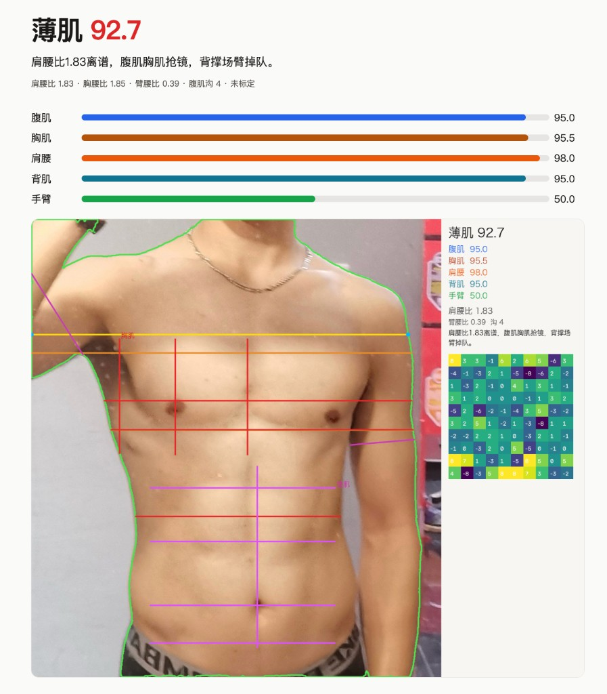

# 薄肌检测器

给一张正面照打外观比例分。核心是腹肌、胸肌和肩腰比，背肌和手臂也记一笔。分数没有用真人照片标定，不是体脂。


[![Contributors][contributors-shield]][contributors-url]
[![Forks][forks-shield]][forks-url]
[![Stargazers][stars-shield]][stars-url]
[![Issues][issues-shield]][issues-url]
[![License][license-shield]][license-url]

[contributors-shield]: https://img.shields.io/github/contributors/aibox22/lean_muscle_detector.svg?style=flat-round
[contributors-url]: https://github.com/aibox22/lean_muscle_detector/graphs/contributors
[forks-shield]: https://img.shields.io/github/forks/aibox22/lean_muscle_detector.svg?style=flat-round
[forks-url]: https://github.com/aibox22/lean_muscle_detector/network/members
[stars-shield]: https://img.shields.io/github/stars/aibox22/lean_muscle_detector.svg?style=flat-round
[stars-url]: https://github.com/aibox22/lean_muscle_detector/stargazers
[issues-shield]: https://img.shields.io/github/issues/aibox22/lean_muscle_detector.svg?style=flat-round
[issues-url]: https://github.com/aibox22/lean_muscle_detector/issues
[license-shield]: https://img.shields.io/github/license/aibox22/lean_muscle_detector.svg?style=flat-round
[license-url]: https://github.com/aibox22/lean_muscle_detector/blob/master/LICENSE.txt

## 关于

本地网页上传一张正面照。服务用 ViTPose 读关节点，用 SAM 3.1 分出人体轮廓，再用 OpenCV 在腹肌和胸肌区域找线。照片和 `VLMRUN_API_KEY` 都留在本机。总结那一句话只看数字，不看照片。

下图是一次真实正面照的结果：总分 92.7，腹肌沟 4 条，肩腰比 1.83，手臂 50.0。绿线是人体轮廓，红线是胸肌，粉线是腹肌。



## 功能

- 五项分数：腹肌 0.35、胸肌 0.25、肩腰 0.25、背肌 0.08、手臂 0.07，权重写在 `src/lean_muscle/spec.py`。
- 腹肌按腹部横沟条数和左右是否均衡打分。胸肌看胸腰比，再加上认出来的胸肌线。
- 背肌分是正面照上腋下那一圈有没有比腰宽，不是后背。
- 手可以出画。手臂量不到时仍然标注、打分，并让总结写成「手臂都不漏，可能是太细了」。
- 肩或髋出画、关键点看不清、没有人、或两个大小接近的人时直接拒绝，不打分。
- 调试图画出轮廓、肩腰线、腹肌线、胸肌线和分数。同一张图的姿态和分割结果按内容哈希缓存，总结句子不缓存。

## 技术栈

扫描结果里 Python 约占 93%，页面是一份静态 HTML。依赖来自 `pyproject.toml`。

[](https://www.python.org/)
[](https://fastapi.tiangolo.com/)
[](https://opencv.org/)
[](https://numpy.org/)
[](https://python-pillow.org/)

云端模型走 `https://gateway.vlm.run/v1/openai`：姿态是 `usyd-community/vitpose-plus-large`，分割是 `facebook/sam3.1`，一句话总结是 `qwen/qwen3.8-27b`。

## 目录

```text
lean_muscle_detector/
    ├── images/
        ├── logo.svg
        ├── result.png
    ├── src/
        ├── lean_muscle/
            ├── web/
                ├── index.html
            ├── analyze.py
            ├── app.py
            ├── cache.py
            ├── cli.py
            ├── errors.py
            ├── gateway.py
            ├── geometry.py
            ├── kernels.py
            ├── render.py
            ├── score.py
            ├── spec.py
            ├── summarize.py
    ├── tests/
        ├── test_gateway.py
        ├── test_geometry.py
        ├── test_kernels.py
        ├── test_pipeline.py
        ├── test_score.py
        ├── test_summarize.py
    ├── .env.example
    ├── pyproject.toml
    ├── README.md
```

## 开始使用

需要 Python 3.11 或更新版本，以及一个 [VLM Run](https://app.vlm.run) 的 API key。

```bash
python -m venv .venv
source .venv/bin/activate
pip install -e ".[dev]"
cp .env.example .env
```

在 `.env` 里填上：

```bash
VLMRUN_API_KEY=
```

## 用法

网页：

```bash
uvicorn lean_muscle.app:app --host 127.0.0.1 --port 8765
```

打开 http://127.0.0.1:8765 ，上传 JPEG、PNG 或 WebP。单张不超过 15MB。

命令行会把 JSON 打到终端，并把调试图写到 `outputs/`：

```bash
lean-muscle photo.jpg
python -m lean_muscle photo.jpg --no-summary
```

`--no-summary` 只打分，不调用总结模型。几何条件不满足时进程返回拒绝原因，不会出分。

测试不访问网关：

```bash
pytest
```

## 参与贡献

问题和改动请开到 [Issues](https://github.com/aibox22/lean_muscle_detector/issues) 或 Pull Request。改分数曲线时先改 `src/lean_muscle/spec.py` 里的结点，再补 `tests/`。

## 许可证

仓库里还没有许可证文件。

## 联系

https://github.com/aibox22/lean_muscle_detector
